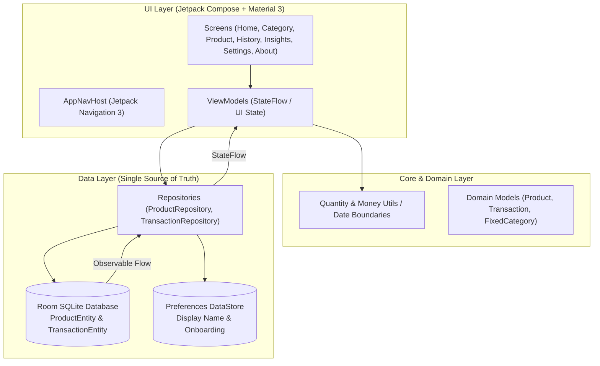

<p align="center">
  
</p>

<h1 align="center">IntiVentory</h1>

<p align="center">
  <strong>Offline-First Native Android Household Inventory &amp; Purchase-Spending Tracker</strong><br>
  <em>మన ఇంటి సరుకులు, మన ఇంటి లెక్కలు. (Our household supplies, our household accounts.)</em>
</p>

<p align="center">
  
  
  
  
  
</p>

---

## Table of Contents

- [Overview](#overview)
- [Key Features](#key-features)
- [Privacy & Offline Guarantee](#privacy--offline-guarantee)
- [Project Status](#project-status)
- [Architecture & Technical Design](#architecture--technical-design)
- [Technology Stack](#technology-stack)
- [Project Structure](#project-structure)
- [Developer Guide & Setup](#developer-guide--setup)
- [AI & Coding-Agent Development Guide](#ai--coding-agent-development-guide)
- [Documentation Index](#documentation-index)

---

## Overview

**IntiVentory** is a privacy-focused, offline-first native Android application built for managing household inventory and tracking purchase spending. Designed specifically for daily household routines, IntiVentory makes it effortless to record incoming grocery and supply purchases (**Add**), track item consumption (**Use**), maintain dimension-safe stock balances, and analyze monthly household expenditure through visual spending insights.

### What Problem Does IntiVentory Solve?

Many households struggle to keep track of pantry stock, cleaning supplies, and recurring expenses using static notebooks or complex spreadsheet templates. Traditional apps often require mandatory user accounts, cloud synchronization, intrusive permissions, or banner advertisements. 

IntiVentory provides a calm, local-first alternative:
* **No Account Required:** Start tracking immediately without sign-up forms, remote authentication, or internet access.
* **Derived Stock Integrity:** Stock balances and spending totals are automatically derived from single-entry transaction records in SQLite, preventing calculation drift.
* **Dimension-Safe Units:** Prevents accidental unit conversion bugs by segregating mass, liquids, and item counts.
* **Time-Limited Safeguards:** Supports editing for record correction while restricting record deletions to a 30-minute window from original recording (`createdAtEpochMs`) to preserve transaction audit integrity.

---

## Key Features

### 🏡 Personalized Home & Greetings
* **First-Run Onboarding:** Display-name setup saved locally in Preferences DataStore (limited to 10 characters).
* **Time-Based Greeting:** Friendly local-time greeting (*Good morning*, *Good afternoon*, *Good evening*) displaying the user's name.
* **Spending Card Preview:** Instant summary of the current calendar month's total purchase spending (`₹`). Tapping the card opens the Insights screen with *This month* selected.
* **Fixed Category Heroes:** Quick access to the three top-level household categories.

### 📦 Preset & Custom Product Management
* **Three Fixed Categories:**
  1. 🌾 **Food & Kitchen** (*Rice, Dal, Flour, Oil, Spices*)
  2. 🧹 **Home Care & Cleaning** (*Toilet Cleaner, Floor Cleaner, Dishwashing Liquid, Detergent, Disinfectant*)
  3. 🧴 **Personal Care & Cosmetics** (*Soap, Shampoo, Toothpaste, Hair Oil, Cream*)
* **Dimension-Safe Measurement Types:** Each product is configured with one fixed measurement dimension:
  * **Mass:** Entered in `kg` or `g` (stored internally in integer grams).
  * **Liquid:** Entered in `L` or `ml` (stored internally in integer millilitres).
  * **Units:** Entered in whole counts/pieces (stored internally as integer counts).
* **Permanent Measurement Lock:** Measurement dimension can be modified until a product receives its first transaction, after which `hasEverHadTransactions` locks it permanently.

### ➕ Add & Use Transactions
* **Add (Purchase / Stock-In):** Records purchase quantity, compatible unit, total INR amount paid (`₹`), and purchase date. Updates stock and spending totals immediately.
* **Use (Consumption / Stock-Out):** Records quantity consumed, compatible unit, and date. Checks available stock atomically to prevent negative stock balances. *Use operations affect inventory quantity only and never alter recorded spending.*

### 📜 Product Transaction History & Correction Rules
* **Auditable Log:** Dedicated date-grouped transaction history per product.
* **Edit Anything:** Edit quantity, compatible unit, amount paid, and transaction date for any historical entry.
* **30-Minute Deletion Cutoff:** Individual transaction deletion is strictly time-limited to 30 minutes after original recording (`createdAtEpochMs`) to preserve audit history.

### 📁 Product Archive & Restore
* **Non-Destructive Hiding:** Archive items to hide them from active category lists while fully preserving stock balances, transaction history, and historical spending.
* **Settings Management:** Review and restore archived products anytime via Settings without data loss or duplicate seeding.

### 📊 Spending Dashboard & Insights
* **Five Period Filters:** *Last 7 days*, *This month*, *Last 3 months*, *Custom date range*, and *All time*.
* **Summary Metrics:** Total expenditure (`₹`), total purchase record count, and average cost per purchase.
* **Spending Trend Bar Chart:** Visual bar chart bucketed by day, week, or month depending on the selected range.
* **Category Share:** Proportional spending breakdown across the three fixed categories.
* **Top Spending Products:** Ranks top 5 spending items in the selected timeframe.

### ℹ️ Settings & About Screen
* **User Profile & Display Name:** Update saved display name.
* **Archived Items Manager:** View and restore archived products.
* **About Screen:** View application branding, Telugu tagline, version details, and developer credits (`ui/about`).

---

## Privacy & Offline Guarantee

IntiVentory is engineered with a strict **local-first, privacy-by-design** approach:

* 🔒 **Zero Internet Permissions:** `android.permission.INTERNET` is not declared in `AndroidManifest.xml`.
* 🛡️ **No Remote Servers or APIs:** All data remains 100% on the user's physical device.
* 🚫 **No Analytics, Telemetry, or Ads:** Zero third-party tracking SDKs.
* 💾 **Local Room Database:** Relational data stored securely in SQLite via Android Jetpack Room.
* ⚙️ **Local DataStore:** Lightweight preferences stored via Jetpack DataStore.

---

## Project Status

IntiVentory has completed core MVP development (**Phases 01–07**):

| Phase | Description | Status | Evidence Baseline |
| :---: | :--- | :---: | :--- |
| **Phase 01** | Android Foundation & Architecture Setup | ✅ Complete | [PR #2](https://github.com/BoyidapuMaheshBabu/IntiVentory-Android/pull/2) — Package structure, Compose, Room, DataStore |
| **Phase 02** | Welcome & Home Screen | ✅ Complete | [PR #3](https://github.com/BoyidapuMaheshBabu/IntiVentory-Android/pull/3) — Onboarding, greeting, category hero cards |
| **Phase 03** | Product Catalogue & Management | ✅ Complete | [PR #5](https://github.com/BoyidapuMaheshBabu/IntiVentory-Android/pull/5) — 15 starter products, custom items, archive/restore |
| **Phase 04** | Add/Use Transactions & Stock Rules | ✅ Complete | [PR #6](https://github.com/BoyidapuMaheshBabu/IntiVentory-Android/pull/6) — Dimension conversions, atomic stock validation |
| **Phase 05** | Product Transaction History & Safeguards | ✅ Complete | [PR #7](https://github.com/BoyidapuMaheshBabu/IntiVentory-Android/pull/7) — Date-grouped audit, 30-min delete cutoff, edit flows |
| **Phase 06** | Spending Dashboard & Insights | ✅ Complete | [PR #8](https://github.com/BoyidapuMaheshBabu/IntiVentory-Android/pull/8) — 5 period filters, trend chart, top products, category shares |
| **Phase 07** | Verification & Intended-User Acceptance | ✅ Complete | [Main Baseline](https://github.com/BoyidapuMaheshBabu/IntiVentory-Android/tree/main) — Owner physical-device acceptance confirmed (2026-11-02) |

> [!NOTE]  
> **Deferred Features:** JSON backup/restore is deferred beyond the accepted core MVP and is not currently implemented.

---

## Architecture & Technical Design

IntiVentory follows modern Android architecture recommendations: Single Activity (`MainActivity`), single app module (`:app`), lifecycle-aware Jetpack Compose UI, ViewModel state management, clean domain boundaries, and Room SQLite database as the single source of truth.



### Core Architecture Principles

1. **Single Source of Truth:** Room database is the sole authority for product and transaction records. Stock balances ($\text{Add} - \text{Use}$) and spending totals ($\sum \text{Add}$) are dynamically derived from saved transaction entities via SQLite aggregate queries.
2. **Dimension Safety:** `QuantityUtils` handles exact, overflow-safe decimal conversions between compatible units (`kg ↔ g`, `L ↔ ml`) using `BigDecimal` arithmetic, storing exact integer base units (`g`, `ml`, `count`) in SQLite.
3. **Currency Integrity:** Money is parsed using `MoneyUtils` and stored internally as integer paise (`Long`) to prevent floating-point rounding errors.
4. **Time-Limited Safeguards:** Individual transaction deletion is restricted to $\le 30$ minutes after initial recording (`createdAtEpochMs`), enforced at both repository/DAO and ViewModel layers.

Detailed technical design and database schema specifications are documented in [docs/ARCHITECTURE.md](docs/ARCHITECTURE.md).

---

## Technology Stack

| Layer / Concern | Technology | Version / Specification |
| :--- | :--- | :--- |
| **Language** | Kotlin | `2.1.0` |
| **Build System** | Gradle (Groovy Build Scripts, Version Catalog) | AGP `8.9.2`, Gradle `8.11.1` |
| **UI Toolkit** | Jetpack Compose + Material 3 | Compose BOM `2024.10.01` |
| **Navigation** | Jetpack Navigation 3 | `androidx.navigation3:1.0.0` |
| **Database** | Room SQLite Database | `androidx.room:2.6.1` with Google KSP |
| **Preferences** | Preferences DataStore | `androidx.datastore:1.1.1` |
| **Async & Reactive** | Kotlin Coroutines & Flow | `1.9.0` |
| **Architecture** | ViewModel + Repository | Android Jetpack Architecture Components |
| **Target Platforms** | Native Android | `minSdk 26` (Android 8.0+), `targetSdk 35`, `compileSdk 36` |
| **Java Compatibility** | JDK / JVM Target | Java 17 |

---

## Project Structure

```text
IntiVentory-Android/
├── build.gradle                    # Root Gradle build script
├── settings.gradle                 # Gradle project settings
├── gradlew                         # Gradle wrapper executable (Unix)
├── gradlew.bat                     # Gradle wrapper batch script (Windows)
├── gradle/
│   └── libs.versions.toml          # Central Gradle Version Catalog
├── app/
│   ├── build.gradle                # App module Groovy Gradle build script
│   └── src/main/java/com/boyidapu/homestock/
│       ├── app/                    # Application class, MainActivity, AppContainer (DI)
│       ├── core/                   # Pure utility functions (dates, money, quantity)
│       │   ├── dates/              # Calendar date ranges & trend bucket calculations
│       │   ├── money/              # INR currency parsing & paise formatting
│       │   └── quantity/           # Unit conversions & dimension validation
│       ├── data/                   # Data layer implementation
│       │   ├── local/              # Room Database, DAOs, entities, catalog seeder
│       │   ├── preferences/        # DataStore display name persistence
│       │   └── repository/         # Repository implementations
│       ├── domain/                 # Domain models & repository interfaces
│       │   ├── model/              # Domain data classes (Product, Transaction, etc.)
│       │   └── repository/         # Domain repository abstractions
│       ├── navigation/             # Navigation 3 backstack & destination routing
│       └── ui/                     # Jetpack Compose UI screens & ViewModels
│           ├── about/              # About screen, version info & brand details
│           ├── archived/           # Archived products manager & restore flow
│           ├── category/           # Product catalogue per fixed category
│           ├── history/            # Date-grouped product transaction history
│           ├── home/               # Greeting, settings gear, spending card, category heroes
│           ├── insights/           # Spending dashboard, period filters & charts
│           ├── onboarding/         # First-run welcome & display-name setup
│           ├── product/            # Create & Edit product forms
│           ├── settings/           # Name settings, archived products link & app info
│           ├── theme/              # Material 3 color palette, typography & theme
│           └── transaction/        # Add (purchase) & Use (consumption) transaction forms
├── docs/                           # Project specifications & architecture documentation
│   ├── adr/                        # Architecture Decision Records (ADRs)
│   ├── assets/                     # SVG branding & logo assets
│   ├── phases/                     # Verification records for completed phases
│   ├── ACCEPTANCE-TESTS.md         # Full acceptance test suite catalogue
│   ├── ARCHITECTURE.md             # Detailed technical architecture specification
│   ├── BRANDING.md                 # Visual identity & brand style guide
│   ├── DEVELOPMENT-WORKFLOW.md     # Multi-stage engineering lifecycle guidelines
│   ├── PRD.md                      # Product Requirements Document
│   ├── PROGRESS.md                 # Progress snapshot
│   └── ROADMAP.md                  # Development phase roadmap
├── AGENTS.md                       # Mandatory rules for Friday & AI coding agents
├── AI-DIRECTOR.md                  # Workflow instructions for Conversational AI Director
└── README.md                       # Repository landing page
```

---

## Developer Guide & Setup

### Environment Prerequisites
* **JDK:** Java 17 (configured in Android Studio).
* **Android Studio:** Android Studio Ladybug (2024.2.1) or newer recommended.
* **Android SDK:** API Level 36 SDK installed (`minSdk 26`, `targetSdk 35`).
* **Device / Emulator:** Android 8.0+ (API 26+) physical device or emulator.

### Building & Running from Android Studio
1. Clone the repository:
   ```bash
   git clone https://github.com/BoyidapuMaheshBabu/IntiVentory-Android.git
   ```
2. Open Android Studio and choose **File > Open**, selecting the `IntiVentory-Android` directory.
3. Allow Gradle to sync dependencies automatically.
4. Select the `app` run configuration and click **Run (Shift + F10)** to deploy to your connected device/emulator.

### Command Line Gradle Operations

#### Run Unit Tests
* **Windows PowerShell:**
  ```powershell
  .\gradlew.bat test
  ```
* **Windows Command Prompt (CMD):**
  ```cmd
  gradlew.bat test
  ```
* **macOS / Linux:**
  ```bash
  ./gradlew test
  ```

#### Build Debug APK
* **Windows PowerShell:**
  ```powershell
  .\gradlew.bat assembleDebug
  ```
* **Windows Command Prompt (CMD):**
  ```cmd
  gradlew.bat assembleDebug
  ```
* **macOS / Linux:**
  ```bash
  ./gradlew assembleDebug
  ```
* **Generated APK Location:** `app/build/outputs/apk/debug/app-debug.apk`

---

## AI & Coding-Agent Development Guide

IntiVentory employs an owner-controlled, AI-assisted development workflow. Separate instructions govern conversational planning AI assistants and IDE coding agents:

```
Repository Analysis ➔ Discussion ➔ Phase Definition ➔ Owner Approval ➔ Branch Preparation ➔ Implementation ➔ Testing ➔ Owner Review ➔ Commit ➔ Pull Request ➔ Merge
```

### 🧠 AI Director Instructions (`AI-DIRECTOR.md`)
* **Role:** Conversational / planning AI assistant (e.g., ChatGPT).
* **Responsibilities:** Analyzes repository context, discusses requirements with the project owner, defines single-objective phase briefs, and prepares structured prompts for branch preparation and implementation.
* **Key Constraint:** *Analysis request is not implementation authorization.*

### 🤖 Agent Instructions (`AGENTS.md`)
* **Role:** Coding agent (Friday in Android Studio).
* **Responsibilities:** Executes explicitly assigned and approved tasks, performs safe Git operations, respects work-stage authorization boundaries, enforces architectural invariants, and provides exact test/build verification reports.
* **Key Constraint:** *Never use shell-based file editing tools (`sed`, `echo`, `cat`) or commit directly to `main` without authorization.*

### 📐 Development Workflow (`docs/DEVELOPMENT-WORKFLOW.md`)
* Comprehensive 7-stage lifecycle detailing authorization gates, evidence standards, branch naming conventions (`phase/NN-short-description`, `chore/short-description`), and physical-device verification rules.

---

## Documentation Index

| Document | Description |
| :--- | :--- |
| 📋 [AI-DIRECTOR.md](AI-DIRECTOR.md) | AI Director conversational planning & coordination rules |
| 🤖 [AGENTS.md](AGENTS.md) | Coding-agent repository rules, stage authorization & safety |
| 📄 [PRD.md](docs/PRD.md) | Product Requirements Document — features, business rules & UI flows |
| 🏗️ [ARCHITECTURE.md](docs/ARCHITECTURE.md) | System architecture, Room schema, unit models & data flows |
| 🧪 [ACCEPTANCE-TESTS.md](docs/ACCEPTANCE-TESTS.md) | Full acceptance test catalogue and verification scenarios |
| 🗺️ [ROADMAP.md](docs/ROADMAP.md) | Development roadmap, phase history & acceptance checkpoints |
| 📈 [PROGRESS.md](docs/PROGRESS.md) | Project status snapshot & baseline records |
| 🎨 [BRANDING.md](docs/BRANDING.md) | Visual identity, logo assets, Telugu tagline & color palette |
| 🔄 [DEVELOPMENT-WORKFLOW.md](docs/DEVELOPMENT-WORKFLOW.md) | Phase-by-phase development lifecycle & evidence guidelines |
| 📑 [Phase Records](docs/phases/README.md) | Verification logs and design references for completed phases |
| 💡 [Architecture Decision Records](docs/adr/README.md) | Records of key technical decisions and trade-offs |

---

<p align="center">
  Developed with ❤️ for household peace of mind. Local-first, private, and reliable.
</p>
