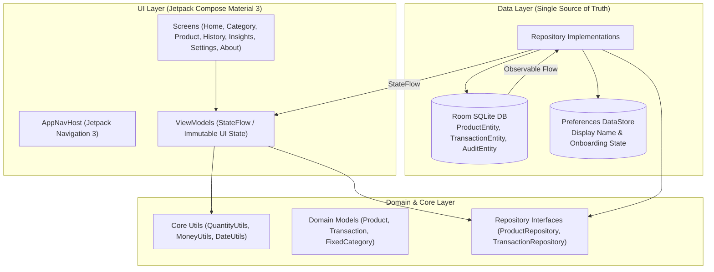

# IntiVentory System Architecture

**Document Status:** Architectural baseline for the accepted Phase 01–07 MVP.  
**Product Identity:** IntiVentory (*ఇంటి వెంటరీ*)  
**Technical Identifier:** Application ID: `com.boyidapu.homestock` | Single Module: `:app`

---

## 1. Architectural Overview & Summary

IntiVentory is a single-user, offline-first native Android application. It contains no cloud database, remote backend, or network communication. Its primary technical complexity lies in local data consistency: stock balances, transaction history, dimension unit conversions, and spending analytics must stay synchronized at all times.



---

## 2. Technical Stack & Build Configuration

| Architectural Component | Decision / Technology |
| :--- | :--- |
| **Application Type** | Native Android |
| **Language** | Kotlin `2.1.0` |
| **Build System** | Gradle (`8.11.1`), AGP (`8.9.2`), Groovy build scripts (`build.gradle`, `app/build.gradle`), Version Catalog (`libs.versions.toml`) |
| **SDK Specs** | `minSdk 26` (Android 8.0+), `targetSdk 35`, `compileSdk 36`, JDK 17 |
| **UI Toolkit** | Jetpack Compose + Material 3 (Compose BOM `2024.10.01`) |
| **Navigation** | Jetpack Navigation 3 (`androidx.navigation3:1.0.0`) |
| **Local Persistence** | Room SQLite Database `2.6.1` with Google KSP |
| **Preferences Storage** | Preferences DataStore `1.1.1` |
| **Concurrency & Async** | Kotlin Coroutines `1.9.0` & Reactive Flow |
| **Dependency Injection** | Manual `AppContainer` (lightweight, single-module) |
| **Network & Sync** | None (0 internet permissions, 100% offline) |

---

## 3. Package Structure (`app/src/main/java/com/boyidapu/homestock/`)

```text
com.boyidapu.homestock/
├── app/                        # Application setup, MainActivity, AppContainer DI
│   ├── AppContainer.kt         # Manual dependency injection container
│   ├── HomeStockApplication.kt # Base Application class
│   └── MainActivity.kt         # Single Activity entry point
├── core/                       # Pure Kotlin utility modules
│   ├── dates/                  # DateUtils (calendar boundaries & aggregation buckets)
│   ├── money/                  # MoneyUtils (Rupee/paise parsing & formatting)
│   └── quantity/               # QuantityUtils (unit conversion & dimension validation)
├── data/                       # Data layer implementation
│   ├── local/                  # Room Database, DAOs, entities, catalog seeder
│   │   ├── dao/                # ProductDao, TransactionDao, TransactionAuditDao, MetadataDao
│   │   ├── entity/             # ProductEntity, TransactionEntity, AuditEntity, etc.
│   │   └── seed/               # CatalogSeeder (seeds 15 starter products once)
│   ├── preferences/            # UserPreferences (DataStore display-name manager)
│   └── repository/             # ProductRepositoryImpl, TransactionRepositoryImpl, UserRepositoryImpl
├── domain/                     # Domain Layer
│   ├── model/                  # Domain data models & enums
│   └── repository/             # ProductRepository, TransactionRepository, UserRepository interfaces
├── navigation/                 # Navigation 3 setup
│   ├── AppNavHost.kt           # Navigation 3 composable route definitions
│   └── Screen.kt               # Type-safe screen destination definitions
└── ui/                         # Presentation Layer (Composables & ViewModels)
    ├── about/                  # AboutScreen (app branding, version, credits)
    ├── archived/               # ArchivedProductsScreen & ViewModel
    ├── category/               # CategoryScreen & ViewModel
    ├── history/                # ProductHistoryScreen & ViewModel
    ├── home/                   # HomeScreen, HomeViewModel & GreetingUtils
    ├── insights/               # InsightsScreen & ViewModel
    ├── onboarding/             # WelcomeScreen & ViewModel
    ├── product/                # CreateProductScreen & EditProductScreen
    ├── settings/               # SettingsScreen & ViewModel
    ├── theme/                  # Material 3 Color, Type, and Theme tokens
    └── transaction/            # AddTransactionScreen & UseTransactionScreen
```

---

## 4. Storage & Persistence Blueprint

### 4.1 Preferences DataStore (`UserPreferences`)
Stores lightweight key-value application state:
* `user_display_name` (String, truncated to max 10 characters).
* `onboarding_completed` (Boolean).

*DataStore does not store inventory items, stock quantities, or transaction history.*

### 4.2 Room Database Entities (`AppDatabase`)
Room SQLite database is the **Single Source of Truth** for inventory and financial records.

#### `ProductEntity` (`products` table)
* `id` (Long, Primary Key, AutoGenerate)
* `categoryId` (String: `FOOD_KITCHEN`, `HOME_CARE_CLEANING`, `PERSONAL_CARE_COSMETICS`)
* `name` (String, max 40 characters)
* `measurementDimension` (String: `MASS`, `LIQUID`, `UNITS`)
* `isPreset` (Boolean)
* `isArchived` (Boolean)
* `hasEverHadTransactions` (Boolean, set to `true` on first transaction; permanently locks measurement dimension)
* `createdAtEpochMs` (Long)

#### `TransactionEntity` (`inventory_transactions` table)
* `id` (Long, Primary Key, AutoGenerate)
* `productId` (Long, Foreign Key -> `products.id` ON DELETE CASCADE)
* `type` (String: `ADD`, `USE`)
* `quantityBaseUnit` (Long, base unit: `g`, `ml`, or `count`)
* `entryUnit` (String: `kg`, `g`, `L`, `ml`, `count`)
* `amountPaidPaise` (Long?, paise amount for `ADD`; null for `USE`)
* `transactionDateEpochDay` (Long, local calendar date)
* `createdAtEpochMs` (Long, immutable system timestamp recorded at save time)

#### `TransactionEditAuditEntity` (`transaction_edit_audits` table)
* Audit log tracking historical edits for integrity verification.

---

## 5. Mathematical Models & Data Safeguards

### 5.1 Unit Conversion & Dimension Safety (`QuantityUtils`)
Base units stored in SQLite:
* **Mass:** Base unit = Grams (`g`). Converts `1 kg = 1000 g`. Input allows up to 3 decimal places for `kg`.
* **Liquid:** Base unit = Millilitres (`ml`). Converts `1 L = 1000 ml`. Input allows up to 3 decimal places for `L`.
* **Units:** Base unit = Count (`count`). Inputs are positive whole integers.

$$\text{Mass Base (g)} = \text{round}(\text{Value}_{\text{kg}} \times 1000)$$
$$\text{Liquid Base (ml)} = \text{round}(\text{Value}_{\text{L}} \times 1000)$$

Dimensions are strictly segregated. `QuantityUtils` rejects conversions between incompatible dimensions (e.g., Mass to Liquid).

### 5.2 Currency Representation (`MoneyUtils`)
* Currency: INR (`₹`).
* Stored as integer paise (`Long`) to prevent binary floating-point inaccuracy:
$$\text{Paise} = \text{round}(\text{Amount}_{\text{INR}} \times 100)$$
* Free purchases (`₹0.00`) are valid for `ADD` transactions, contributing `0` to spending while increasing inventory stock.

### 5.3 Derived Stock & Spending Principles

$$\text{Current Stock} = \sum \text{ADD quantities (base units)} - \sum \text{USE quantities (base units)}$$

$$\text{Total Purchase Spending} = \sum \text{ADD amountPaidPaise (for selected range)}$$

* Stock and spending are **never stored as editable columns** in the database. They are computed dynamically via SQLite aggregate queries (`SUM`).
* `USE` transactions reduce inventory stock but **never alter recorded spending**.

---

## 6. Business Safeguards & Time Windows

### 6.1 30-Minute Time-Limited Deletion Window
* Individual transaction deletion is permitted **only** when:
$$\text{CurrentTime} - \text{createdAtEpochMs} < 30 \text{ minutes } (1,800,000 \text{ ms})$$
* Enforced strictly at UI, ViewModel, Repository, and DAO levels.
* Editing a transaction does **not** reset or extend `createdAtEpochMs`.

### 6.2 Permanent Dimension Lock
* Measurement dimension can be modified while a product has zero transaction history.
* Once any transaction is saved, `hasEverHadTransactions` is set to `true` and remains `true` permanently, preventing dimension changes even if all transactions are subsequently deleted or current stock returns to zero.

---

## 7. Reactive Data Flow Lifecycle

1. **User Action:** User submits an Add transaction in `AddTransactionScreen`.
2. **ViewModel Validation:** `AddTransactionViewModel` validates quantity, unit compatibility, and paise amount using `QuantityUtils` and `MoneyUtils`.
3. **Repository Execution:** `TransactionRepositoryImpl` executes a Room database insert within a database transaction.
4. **Observable Emitting:** Room DAO emits updated SQLite query results via Kotlin `Flow`.
5. **UI Collection:** Screen ViewModels collect updated data via `StateFlow` and Compose redraws the updated stock and spending totals automatically.
